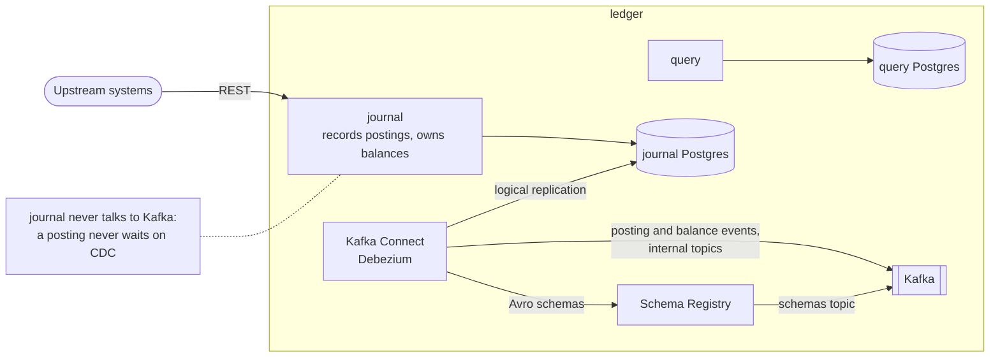

# Containers

Deployment: [docker-compose.yml](../../docker-compose.yml). Components: [journal](../../services/journal/docs/data-model.md), [journal change events](../../services/journal/docs/change-events.md).

