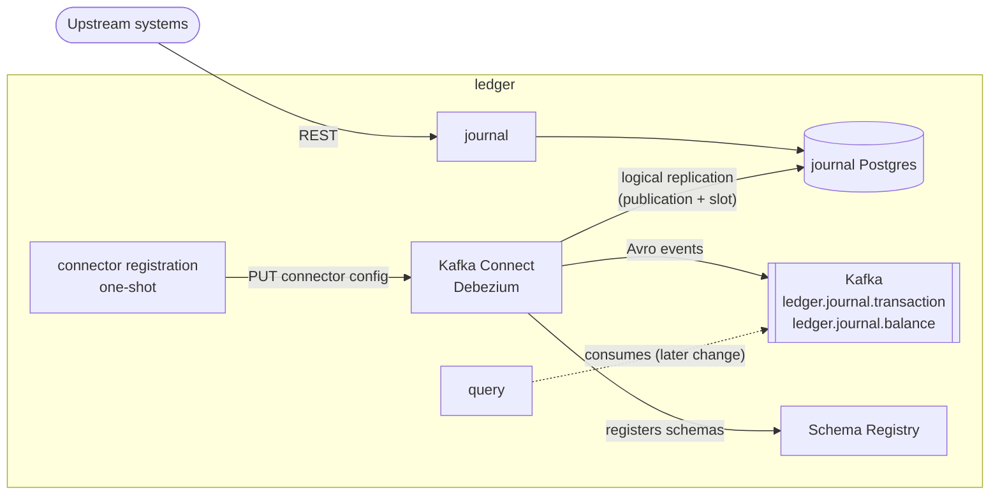
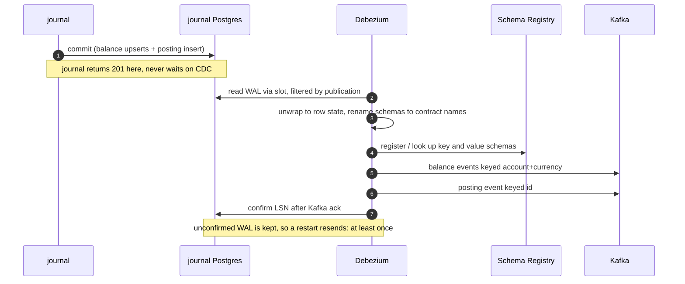

# Design

## Context

`journal.transaction` is append-only with entries and versions as `jsonb` on the row, so one posting is one row insert. `journal.balance` gets exactly one upsert per balance per posting, carrying totals, `version` and `last_transaction_id`. Both were shaped for CDC (see the archived `add-basic-posting` design). The stack already runs Postgres with `wal_level=logical`, a `debezium_user` with `REPLICATION`, Kafka, Schema Registry and a Kafka Connect image with the Avro converter, but no connector is registered. `journal-events` holds an empty `TransactionPosted` placeholder that `query` already depends on. Motivation: proposal.md. Behaviour: `specs/journal/change-events/spec.md`.

## Goals / Non-Goals

**Goals:**
- Table-level CDC of the two journal tables, configured entirely outside `journal`'s application code.
- A hand-written Avro contract that the connector's output is proven to match.
- Zero manual steps: `docker compose up --build` ends with the connector running.

**Non-Goals:**
- Consumers, projections or REST in `query`.
- Production concerns: multi-broker replication, secrets management, monitoring of slot lag.
- Changing the shape of the journal tables.

## Decisions

### Containers

### Flow

**1. Table CDC, not an outbox.** The tables already are the events: one posting row, one balance row per change, each self-contained. An outbox would duplicate every write and add a table for no gain. *Alternative: outbox with Debezium's outbox router* — rejected; it changes the write path the posting specs pin down.

**2. Publication created by `journal`'s Liquibase; slot by Debezium.** In Postgres, `CREATE PUBLICATION ... FOR TABLE` requires owning the tables, and `journal_user` owns them, so a changeset creates `journal_cdc` for `journal.transaction` and `journal.balance`. The connector uses `publication.autocreate.mode=disabled`, plugin `pgoutput`, slot `journal_cdc`. *Alternative: let Debezium autocreate* — rejected: would need `debezium_user` to own the tables or be superuser.

**3. Debezium read grants in `journal-init.sql`.** `ALTER DEFAULT PRIVILEGES FOR ROLE journal_user GRANT USAGE ON SCHEMAS / SELECT ON TABLES TO debezium_user`, so schemas and tables Liquibase creates later are readable for the snapshot. `journal` changesets never mention the Debezium role, so they still run in tests where it doesn't exist.

**4. Row-state events with contract names.** Transforms: `ExtractNewRecordState` (drop tombstones; deletes cannot happen), then `SetSchemaMetadata` per topic (guarded by a topic-name predicate) renaming key and value schemas to `ledger.journal.events.{TransactionKey,TransactionPosted,BalanceKey,BalanceChanged}`, so `query` gets generated classes with real names. Field names stay the column names. `topic.prefix=ledger` gives `ledger.journal.transaction` and `ledger.journal.balance`. Type mapping (Debezium defaults): `uuid` and `jsonb` → string, `timestamptz` → ISO-8601 string, `char(3)` → string, `bigint` → long. *Alternative: route through a custom SMT or Kafka Streams to reshape entries into Avro arrays* — rejected for now: more moving parts; JSON text keeps the REST shape and can become typed later as a compatible evolution.

**5. Contract test by canonical form.** The connector adds `connect.*` properties and semantic-type names, so byte-equal schemas are impossible. The test compares Avro *parsing canonical form* (names, types, field order; props and docs stripped) of each registered writer schema with the `journal-events` schema. The `.avsc` files carry `doc` describing the JSON shape of `entries`, `versions` and `metadata`. Schema Registry's default `BACKWARD` compatibility stays: a future incompatible table change makes the connector fail loudly instead of breaking consumers.

**6. Topics created by Connect.** `topic.creation.default.*`: 1 partition, replication 1, `cleanup.policy=delete`, `retention.ms=-1`, `retention.bytes=-1`. Keys guarantee per-balance order if partitions are raised later. Not compacted: balance history is the point. Broker topic auto-creation is off, so a consumer that starts before the connector cannot create a topic with broker defaults (7-day retention) first.

**7. Snapshot then stream.** `snapshot.mode=initial`: first start emits existing rows (balances as their current state, version included), then streams. Offsets live in Connect's offset topic; the slot keeps WAL until confirmed.

**8. Registration as a compose one-shot.** Connector JSON lives in `docker/kafka-connect/connectors/journal-cdc.json`. A `connector-init` service (curl image) waits for `kafka-connect` and `journal-app` healthy (the latter means Liquibase created the publication) and does an idempotent `PUT /connectors/journal-cdc/config`. *Alternative: a Connect entrypoint script* — rejected: mixes worker and connector lifecycle.

**9. Integration test in `journal-app`.** Testcontainers: Postgres 18 (database `journal`, `wal_level=logical`, the real `journal-init.sql`), Kafka, Schema Registry and Connect built from `docker/kafka-connect/Dockerfile`, on one network. The test boots `journal` against that Postgres, registers the same connector JSON (hostnames swapped), posts through REST and reads topics with a plain Kafka consumer, decoding the Confluent wire format (magic byte, schema id, Avro body) with the writer schema fetched from Schema Registry. This avoids adding the Confluent Maven repository. Kafka is a test-only dependency; `journal`'s main code stays Kafka-free.

## Risks / Trade-offs

- [An idle or removed connector leaves the slot pinning WAL, filling the journal disk] → dev only for now; set `max_slot_wal_keep_size` on journal Postgres in compose; `docker compose down -v` resets. Production lag monitoring is a later concern.
- [Posting and balance events are not atomic across topics] → by spec; balance events are self-contained and link via `last_transaction_id`.
- [`entries`/`versions`/`metadata` are untyped JSON text in Avro] → shape documented in the `.avsc` docs and pinned to the REST response by a test; typing them later is a contract evolution.
- [Any future journal migration changes the event contract] → contract test fails in the build; Schema Registry rejects backward-incompatible schemas at runtime.
- [The CDC test is slow (four containers)] → one test class sharing containers; it covers every scenario in one run.
- [`idempotency_key` leaves the journal] → acceptable: same trust zone; listed in the contract.

## Migration Plan

1. Deploy the `journal` migration (publication) — harmless without a connector.
2. Apply the init-script grants: they only run on an empty volume, so existing dev volumes need `docker compose down -v` (documented in README) or a manual grant.
3. Register the connector; the initial snapshot publishes existing data.

Rollback: delete the connector, drop the slot (`pg_drop_replication_slot('journal_cdc')`) and the publication (Liquibase rollback); delete the topics.
