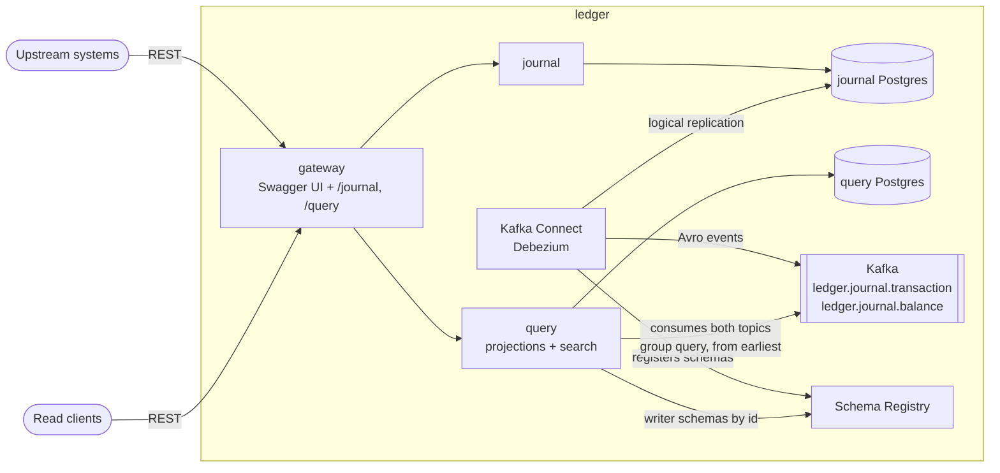
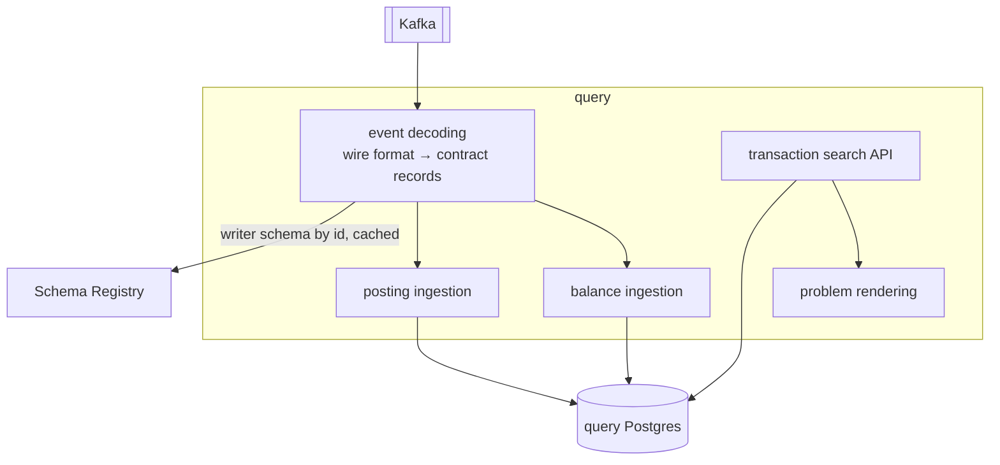
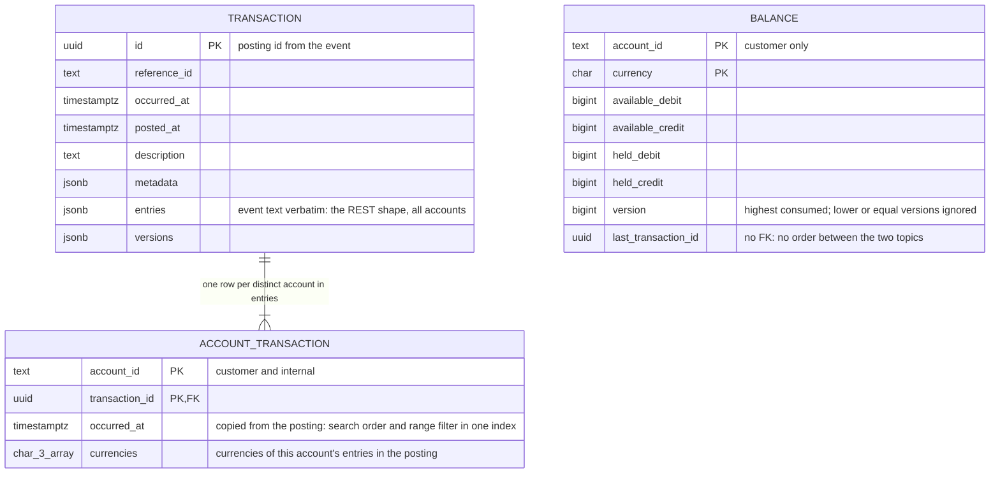
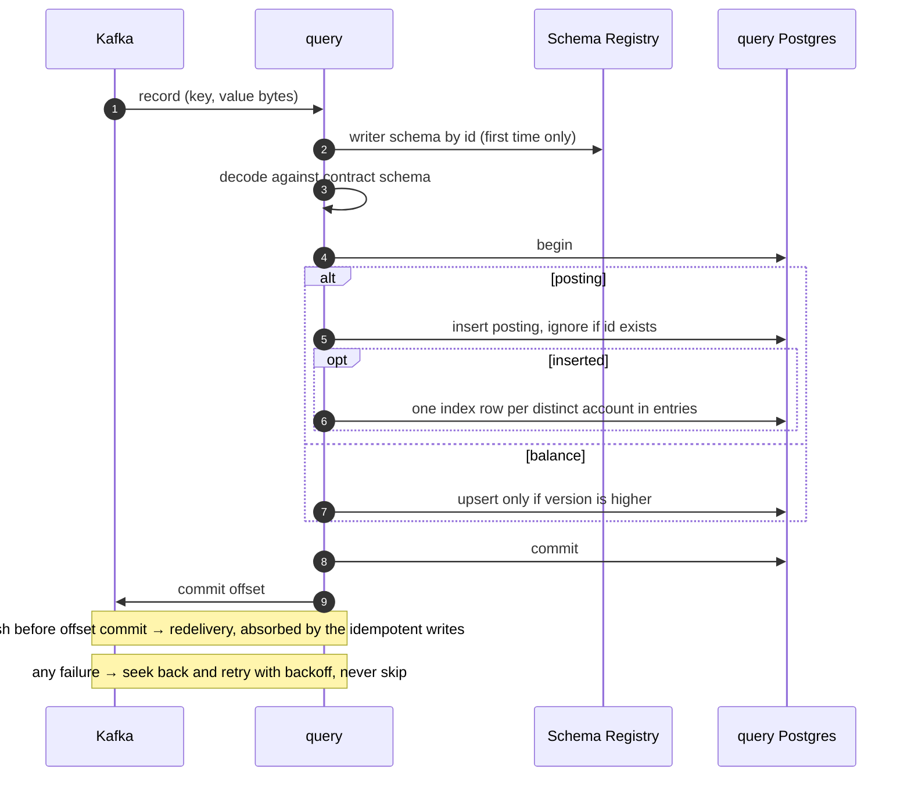
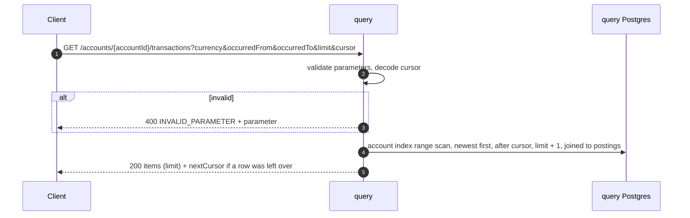

# Design

## Context

`journal` publishes `ledger.journal.transaction` (one event per posting, keyed by id) and `ledger.journal.balance` (one event per customer balance change, keyed by account and currency), Avro in the Confluent wire format, schemas registered by the connector under the `journal-events` contract names. Both topics have one partition, infinite retention and no compaction; delivery is at least once and only per-balance order is guaranteed (`openspec/specs/journal/change-events`). `entries`, `versions` and `metadata` are JSON text with the journal REST shape; timestamps are RFC 3339 strings.

`query` is a scaffold: Spring Boot app on 8081, Liquibase creating schema `query` (tracking tables in `public`), a dependency on `journal-events` (generated Avro classes), its own Postgres and `query_user`. It has no Kafka dependency, no REST contract and is not behind the gateway. The journal's CDC test already decodes the wire format without the Confluent client libraries (Confluent artifacts are not on Maven Central). Motivation: proposal.md. Behaviour: `specs/query/transaction-search/spec.md`, `specs/query/account-balances/spec.md`.

## Goals / Non-Goals

**Goals:**
- Idempotent, order-tolerant projections fed by at-least-once events, rebuildable by replaying the topics from the start.
- Keyset-paged account search that stays index-only on the account, whatever the account's size.
- Contract-first REST for `query`, validated in tests the same way as `journal`.

**Non-Goals:**
- Balance REST, balance history, search by `referenceId` or other fields.
- Consumer lag monitoring, alerting on a blocked partition, a dead-letter topic.
- Running Debezium in `query`'s tests: the journal's CDC test proves the connector output matches `journal-events`.

## Decisions

### Containers

### Components of query

### Data model

Index `(account_id, occurred_at DESC, transaction_id DESC)` on `account_transaction` serves search order, range and cursor. No `idempotency_key` column: nothing reads it.

**1. One index row per account and posting, currencies as an array.** Search without a currency filter is the common case and needs each posting once; one row per (account, posting) makes that a plain index range scan with keyset paging. The currency filter is `currencies @> ARRAY[:currency]`, applied while walking the same index. *Alternative: one row per (account, currency, posting)* — rejected: unfiltered search would need `DISTINCT` over rows sharing a posting, which breaks a simple keyset. Cost: a currency filter on an account active in many currencies scans the non-matching rows too; customer accounts are mostly single-currency and internal accounts are named per currency.

**2. Order by `occurredAt`, then id.** Clients filter by `occurredAt`, so ordering by it keeps filter and order on one index. `posted_at` is display-only and the UUIDv7 id is not ordered within a millisecond; neither gives commit order across accounts. The id only breaks ties.

**3. Cursor = position, base64url of `occurredAt` and id.** Opaque to clients, unsigned: a forged but well-formed cursor only moves the keyset start, it reveals nothing. Undecodable → `400 INVALID_PARAMETER cursor`. Filters are not embedded; the client resends them. Fetch `limit + 1` rows to decide `nextCursor` without an extra page. Keyset predicate `(occurred_at, transaction_id) < (:o, :id)` keeps pages stable while postings arrive; a posting ingested later with an `occurredAt` behind the cursor is not seen by that walk (allowed by the spec).

**4. Decode in the listener, from bytes.** Consumers read `byte[]` key and value; the listener decodes the Confluent wire format (magic byte, schema id, Avro body), fetching the writer schema from Schema Registry by id (cached forever: ids are immutable) and resolving it against the generated `journal-events` reader schema. *Alternative: Confluent `KafkaAvroDeserializer`* — rejected as in the CDC change: it needs the Confluent Maven repository. *Alternative: a Kafka deserializer* — rejected: a deserializer failure is classified as non-retryable by the Spring Kafka error handler and the record is skipped, which the specs forbid. Decoding in the listener routes every failure through the same retry path.

**5. Never skip: infinite retry with capped backoff.** The container's error handler retries the failed record forever (exponential backoff capped at 1 minute) by seeking back, so its partition stops while other topics continue. No dead-letter topic (broker auto-create is off and a skipped posting would silently be missing from search). A blocked partition is visible in logs; alerting is a non-goal.

**6. Commit offsets after the database commit; writes are idempotent.** Each record is processed in one database transaction; Spring Kafka acknowledges it only after the listener returns (record ack mode). A crash between commit and acknowledgement redelivers the record, which the writes absorb:
- posting: `INSERT … ON CONFLICT (id) DO NOTHING`; account rows only when the posting row was inserted;
- balance: `INSERT … ON CONFLICT (account_id, currency) DO UPDATE … WHERE balance.version < excluded.version`.

*Alternative: Kafka transactions / exactly-once* — not applicable across Kafka and Postgres; idempotent sinks are simpler.

**7. One listener per topic, group `query`, `auto.offset.reset=earliest`.** Topics have one partition, so concurrency 1 each. Earliest makes a fresh deployment replay everything (specs: data published before `query` started). Missing topics are not fatal: in compose the connector registers after `journal` is healthy, and `query` must start before the topics exist without creating them (auto-create is off on the broker).

**8. Contract-first REST.** `query-app/src/main/openapi/openapi.yaml` is hand-written, server `/query`. It declares `GET /accounts/{accountId}/transactions` with `TransactionPage {items, nextCursor}` and its own copies of the posting schemas (`Posting`, `Entry`, `BalanceVersion`, `AccountId`, `Currency`, …). *Alternative: `$ref` into journal's document* — rejected: each service owns and publishes its contract independently; the shapes are kept in sync by the "item equals the recorded posting" scenario. Parameter checks are done in the controller, not by bean validation, so each failure maps to exactly one `parameter`; problems are RFC 9457 with `code: INVALID_PARAMETER` and `parameter`. Tests validate MockMvc traffic against the document with the Swagger request validator, as in `journal`.

**9. Timestamps.** Event strings are parsed to instants and stored as `timestamptz`; responses render RFC 3339 in UTC. `entries`, `versions` and `metadata` are stored as `jsonb` from the event text and returned as JSON (key order may differ from the journal's response; JSON equality holds).

**10. Plain JDBC.** Same as `journal`: `spring-boot-starter-jdbc` with hand-written SQL. Upserts with version guards and keyset queries are clearer in SQL than through an ORM.

**11. Tests without Debezium.** Testcontainers Postgres, Kafka (`apache/kafka`) and Schema Registry (`cp-schema-registry`, generic container). A test producer registers the `journal-events` schemas under the topic subjects and writes wire-format records. This covers ingestion (duplicates, stale versions, replay from earliest, poison record blocking) and search end to end inside `query`. A compose smoke check covers the real chain.

**12. Compose and gateway.** `query-app` gets `KAFKA_BOOTSTRAP_SERVERS=kafka:29092` and `SCHEMA_REGISTRY_URL=http://schema-registry:8081`; local defaults point at the host ports (9092, 8085). The gateway routes `/query/` to `query-app:8081` (prefix stripped) and Swagger UI lists `query.yaml`.

## Risks / Trade-offs

- [A poison event blocks its topic forever] → intended (no silent gaps); visible in logs; a fix is a code or contract change followed by restart. Alerting left to a later change.
- [Wiping query's database without resetting the consumer group leaves projections empty] → `docker compose down -v` resets Kafka too; the group id is configurable, so a rebuild can use a new group. Documented in the README.
- [Search lags the journal; a client that just posted may not find it] → allowed by the spec (eventual); lag is typically sub-second locally.
- [Hot internal accounts (e.g. settlement) accumulate many index rows] → keyset paging keeps each page an index range scan regardless of size.
- [Backdated postings ingested during a paging walk can be missed by that walk] → accepted by the spec; restarting the walk sees them.
- [Contract duplicated between journal and query OpenAPI documents] → tests in `query` assert item shape against the journal's REST shape fixtures.
- [Schema evolution of `journal-events`] → writer/reader schema resolution tolerates backward-compatible changes; Schema Registry's `BACKWARD` check blocks the rest at the connector.

## Migration Plan

New tables only, created by Liquibase changesets in schema `query`. The new consumer group starts from the earliest offset and backfills every posting and balance already published; no journal or connector change. Rollback: stop `query`; its tables and consumer group can be dropped without affecting `journal`.
