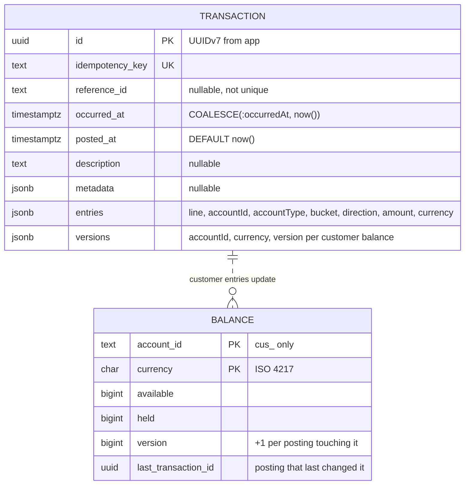
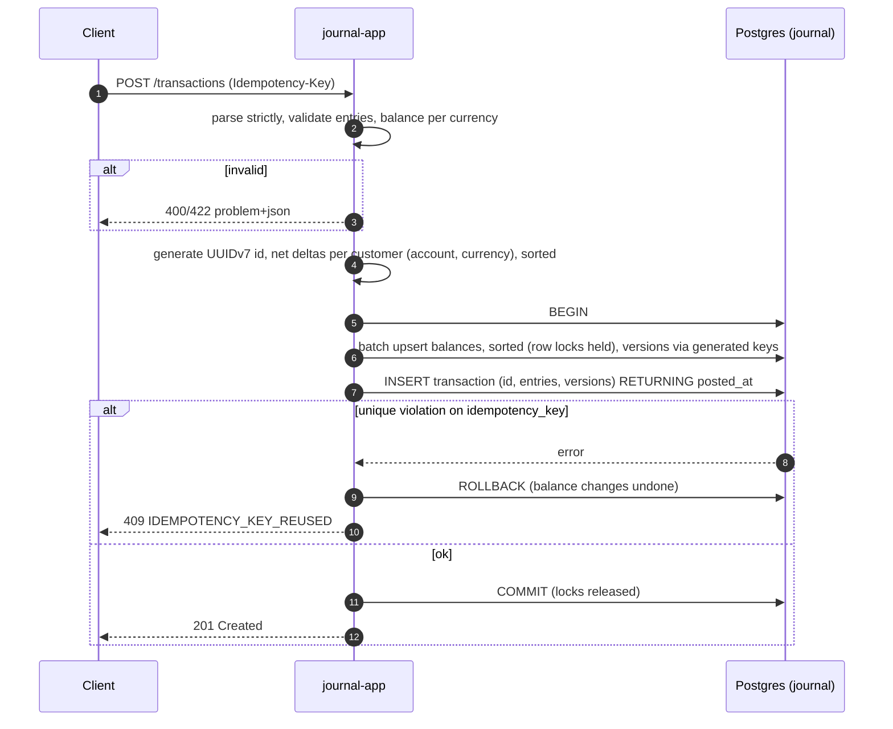

# Design

## Context

`journal-app` is a bare Spring Boot 4 app (webmvc, actuator, Liquibase, Postgres driver) with an empty `journal` schema owned by `journal_user`. Liquibase tracking tables live in `public`. Tests use Testcontainers `postgres:18`. Debezium will later stream the posting log to Kafka (not part of this change). The requirements are in `specs/journal/transaction-posting` and `specs/journal/account-balances`.

## Goals / Non-Goals

**Goals:**
- A write path where postings that touch different customer balances never block each other, and postings that touch the same customer balance serialize in commit order.
- A posting log shaped so that one posting becomes exactly one CDC event later on.
- A balance table shaped so that each balance change becomes one self-contained CDC event (state, version and posting id), giving downstream a balance history.
- Minimal moving parts: two tables and plain SQL statements.

**Non-Goals:**
- Read endpoints, the Debezium connector, the Avro/CDC contract for postings and balances, funds checks, per-kind rules, and an account registry.
- Configuring throughput for hot customer accounts. Internal accounts are never locked, which covers the known hot accounts.

## Decisions

### D1. Posting log is one table, entries as `jsonb`
`journal.transaction` holds the envelope, `entries jsonb` (the request entries plus `line` and `accountType`) and `versions jsonb` (one `{accountId, currency, version}` per customer balance changed). Request, response, storage and the future event all share one shape.
- *Alternative: a separate `journal.entry` table.* Rejected because CDC would emit 1+N events per posting, consumers could see half a posting, and we would need extra tables. Per-entry DB constraints are lost; the app validates every entry before writing.
- *Alternative: one row per (account, currency, version), event-store style.* Rejected because it brings back multi-row postings, does not fit internal entries, and relies on optimistic retries.
- *Alternative: version on each entry.* Rejected because the version belongs to a balance (account + currency), not to a line. Putting it on entries repeats the same number on every line of a balance and leaves internal lines empty.

### D2. One balance row per (customer account, currency) with `available`, `held`, `version` and `last_transaction_id`
This row is also the lock: one row lock per balance, one update per posting. Buckets are columns, so a third bucket would need a schema change. That is acceptable, since cards only need two. Internal accounts have no row.

`last_transaction_id` is the id of the posting that last changed the row. Each posting applies one net change per balance, so every posting produces exactly one row change per balance it touches, with no intermediate states. A future CDC stream of this table then delivers one event per (balance, posting), carrying the new `available`, `held`, `version` and the posting id. Downstream can build a balance history and answer "balance after posting X" from it. Debezium UPDATE events include the full new row by default, so `REPLICA IDENTITY FULL` is not needed.
- *Alternative: one row per bucket.* Rejected because it means two locks and two upserts for every hold.

### D3. Account type from id prefix
Account ids match `^cus_[0-7][0-9a-hjkmnp-tv-z]{25}$` (TypeID) or `^int_[A-Z][A-Z0-9_]{2,63}$`. The derived `accountType` is stored in the entry.
- *Alternatives: type sent on each entry, or an account registry.* Per-entry type allows contradictions across postings. A registry adds read-before-write and coupling on account creation.

### D4. Integer minor units, `bigint` everywhere
JSON integers (Jackson fails on floats), capped at 10^15 per entry. The currency must be valid for `java.util.Currency` with `getDefaultFractionDigits() >= 0`. The number of minor-unit digits is not needed for validation, only for display.

### D5. Batched upserts plus one insert in one DB transaction
The app parses and validates the request, then computes the net `d_available`/`d_held` for each customer balance `(account_id, currency)` touched by the posting and sorts them by `account_id`, then `currency`. Inside one `@Transactional` method:

1. One JDBC batch of this upsert, one batch item per balance in sorted order:
   ```sql
   INSERT INTO journal.balance (account_id, currency, available, held, version, last_transaction_id)
   VALUES (:accountId, :currency, :dAvailable, :dHeld, 1, :txId)
   ON CONFLICT (account_id, currency) DO UPDATE
      SET available = balance.available + EXCLUDED.available,
          held      = balance.held      + EXCLUDED.held,
          version   = balance.version + 1,
          last_transaction_id = EXCLUDED.last_transaction_id
   RETURNING version;
   ```
   Each upsert locks its row until commit. `version` is read through `getGeneratedKeys` (`prepareStatement(sql, new String[]{"version"})`), one row per batch item in batch order. The batch is skipped when the posting has no customer entries.
2. `INSERT INTO journal.transaction (...) VALUES (...) RETURNING posted_at`, with the app-generated `id` and `versions` collected from step 1. This is a different statement, so it cannot share the batch.
3. Commit, which releases the locks.

Batch items run in the order they were added, so locks are always taken in sorted order and two postings cannot deadlock. `reWriteBatchedInserts` must stay off: it rewrites the batch into one multi-row INSERT and drops that ordering guarantee. `JdbcClient` has no batch API, so the batch uses `JdbcTemplate.batchUpdate` with a `KeyHolder` if the Boot 4 Spring version offers it, or a plain `PreparedStatement` through `ConnectionCallback`. Round trips per posting are the batch, the insert and the commit, however many balances it touches. A posting with only internal entries takes no locks.
- *Alternative: one CTE statement* (window functions, `jsonb_to_recordset`). It needs fewer round trips but the SQL is much harder to read, and Postgres does not formally guarantee the order in which `ON CONFLICT` processes rows.
- *Alternative: a PL/pgSQL `journal.post(jsonb)` function.* The logic would live in the DB and be harder to test from Java.

### D6. Idempotency through a unique key
`idempotency_key text UNIQUE` is the only mechanism. There is no lookup before writing and no stored request hash. The write runs straight away. If the insert at step 2 violates the unique index, the whole DB transaction rolls back, including its balance upserts, and the client gets `409 IDEMPOTENCY_KEY_REUSED`. Two concurrent requests with the same key: the slower one waits on the same balance rows (if any), then hits the unique index and gets `409`. Round trips per posting: one batch of upserts, one insert, then commit. Keys never expire, so the unique index grows with the log. This is accepted. Returning the original result on a retry (replay) can be added later.

### D7. `id` from the app; `postedAt` and `occurredAt` from the database
The app generates `id` as a UUIDv7 with the JDK's `UUID.ofEpochMillis(System.currentTimeMillis())` (Java 27, no extra library) and sends it in the insert. Ids from the same millisecond are not ordered among themselves; the id is only an identifier, and ordering comes from the per-balance `version`. `posted_at timestamptz DEFAULT now()`. A missing `occurredAt` is stored as `COALESCE(:occurredAt, now())`. Because `now()` is constant within one DB transaction, a missing `occurredAt` equals `postedAt` exactly. `postedAt` is for display only. It is not commit-ordered, and the per-balance `version` is what provides ordering.

### D8. Append-only enforced in the database
A `BEFORE UPDATE OR DELETE` trigger on `journal.transaction` raises an exception. `journal_user` owns the table, so `REVOKE` alone would not stop it.

### D9. Strict JSON and RFC 9457 errors
Jackson is configured to fail on unknown properties, on floats given for ints, on nulls for primitives, and on scalar coercion (for example a string given for an amount). The app checks required fields and envelope length limits before the domain rules, so a missing field, a parse error or an over-long string maps to `400 MALFORMED_REQUEST`. `bucket` is read as a string and checked by domain validation, so an unknown value gives `422 INVALID_BUCKET`. Domain validation returns `422` with a `code` and `line`. A `@RestControllerAdvice` produces Spring `ProblemDetail` responses with a `code` property.

### Data model



### Write path



## Risks / Trade-offs

- [Entries in `jsonb` are untyped in a future Avro event] → document the entries and versions JSON schema as part of the event contract when CDC is added.
- [The posting event and the balance events arrive on different topics and are not atomic with each other] → each balance event is self-contained (state, version, posting id), and consumers that need posting details join on `last_transaction_id`.
- [Locks are held across two app-to-DB round trips (batch, insert)] → this only affects one customer balance. Hot accounts are internal and lock-free.
- [A client retrying after a timeout gets `409` without the original result] → clients treat `409` as "already recorded". Replay can be added later.
- [Concurrent duplicate briefly holds balance locks before failing] → this is rare and harmless. An advisory lock per key can be added if retries prove frequent.
- [Unbounded idempotency index growth] → accepted for now. Partitioning can come later.

## Migration Plan

Additive Liquibase changesets create `journal.transaction`, `journal.balance` and the append-only trigger. There is no existing data. Rollback is to redeploy the previous image and drop both tables (dev only).
