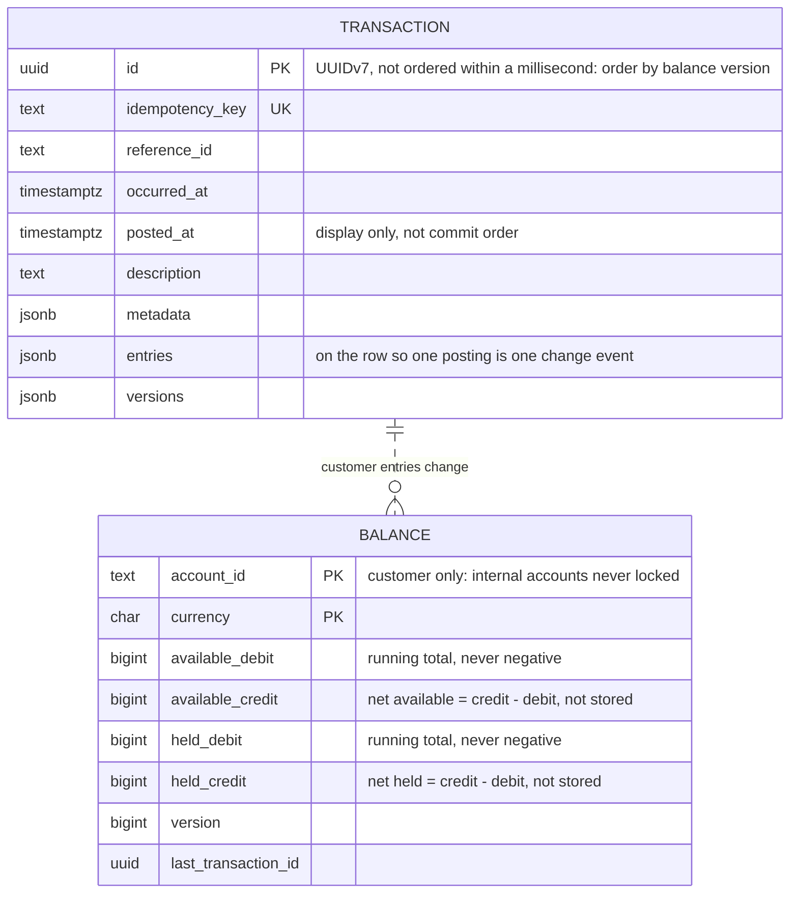

# Design

## Context

`journal.balance` holds one row per customer `(account_id, currency)` with net `available` and `held`, a `version` and the `last_transaction_id`. Each posting computes one net delta per customer balance, sorted in lock order, and applies it with one upsert per balance in a single JDBC batch (see `services/journal/docs/posting.md`). The balance table is not exposed by the REST contract or the `TransactionPosted` event. See proposal.md for motivation and `specs/journal/account-balances/spec.md` for the required behaviour.

## Goals / Non-Goals

**Goals:**
- Replace the two net columns with four non-negative running totals, keeping one row lock and one upsert per balance per posting.
- Migrate existing rows without losing any history, derived from the log rather than from the old nets.

**Non-Goals:**
- Exposing balances over REST or in events.
- Any rule that rejects a posting based on a total or a net.

## Decisions

### D1. Four totals, net not stored

`available_debit`, `available_credit`, `held_debit`, `held_credit` (`bigint NOT NULL`). The net per bucket is `credit - debit`, computed on read.

- Alternative: keep `available`/`held` alongside the totals. Rejected: two sources of truth on one row that must be kept in step.
- Alternative: generated columns for the nets. Rejected for now: nothing reads the nets from SQL today; can be added later without changing behaviour.

### D2. Delta per balance carries four sums

The per-posting delta for a customer `(account, currency)` becomes four sums, one per bucket and direction, instead of two signed nets. Entries on the same bucket and opposite direction are summed into their own totals, never cancelled. The lock order, the single batch and the "one version increment per posting per balance" rule are unchanged. A touched balance always has at least one non-zero total, since amounts are at least 1.

Totals stay non-negative because validated amounts are at least 1 and are only ever added; there is no database check on them.

### D3. Migration as new changesets, backfilled from the log

The existing `create-table-balance` changeset is left untouched (editing it would change its checksum on any database that already ran it). New changeset(s):

1. Add the four columns with `DEFAULT 0`.
2. Backfill each row from `journal.transaction.entries` for customer entries, grouped by account, currency, bucket and direction.
3. Fail the migration if, for any row, `credit - debit` differs from the old `available` / `held`.
4. Drop the defaults, set `NOT NULL`, drop `available` and `held`.

Backfilling from the log rather than copying the nets is the only way to get both sides; the step-3 check proves the log and the old nets agreed. A rollback block recreates `available`/`held` as `credit - debit` and drops the totals.

The write path sequence (`posting.md`) is unchanged: same lock order, same single batch of upserts, same append and idempotency check.

## Risks / Trade-offs

- [Totals only grow, so they overflow before a net would] → `bigint` with amounts capped at 10^15 needs over 9,000 maximum-size entries on one bucket and direction; an overflow raises a database error and rolls the posting back, it never wraps.
- [Backfill reads the whole log at startup] → the log is small at this stage; the migration runs once.
- [Backfill disagrees with the old nets] → the migration fails before dropping anything, leaving the schema as it was.

## Migration Plan

Deploy the new journal image; Liquibase runs the new changesets on startup inside its transaction. Rollback: the changeset's rollback block restores `available`/`held` from the totals.
