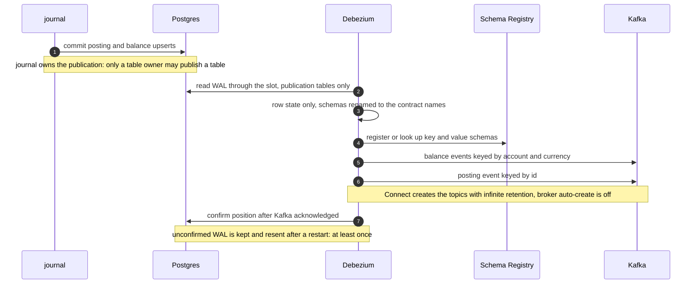

# Change events

Behaviour: [change-events](../../../openspec/specs/journal/change-events/spec.md). Contract: [Avro](../journal-events/src/main/avro/). Connector: [config](../../../docker/kafka-connect/connectors/journal-cdc.json). Tables: [data model](data-model.md).

