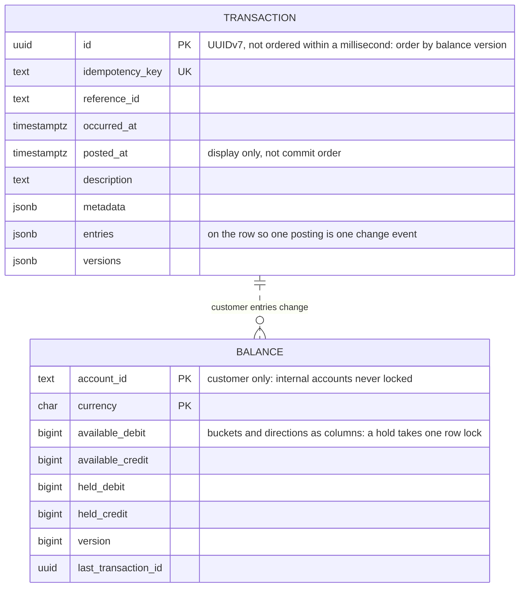

# Data model

Behaviour: [account-balances](../../../openspec/specs/journal/account-balances/spec.md), [transaction-posting](../../../openspec/specs/journal/transaction-posting/spec.md). Tables: [changelog](../journal-app/src/main/resources/db/changelog/db.changelog-master.yaml).

