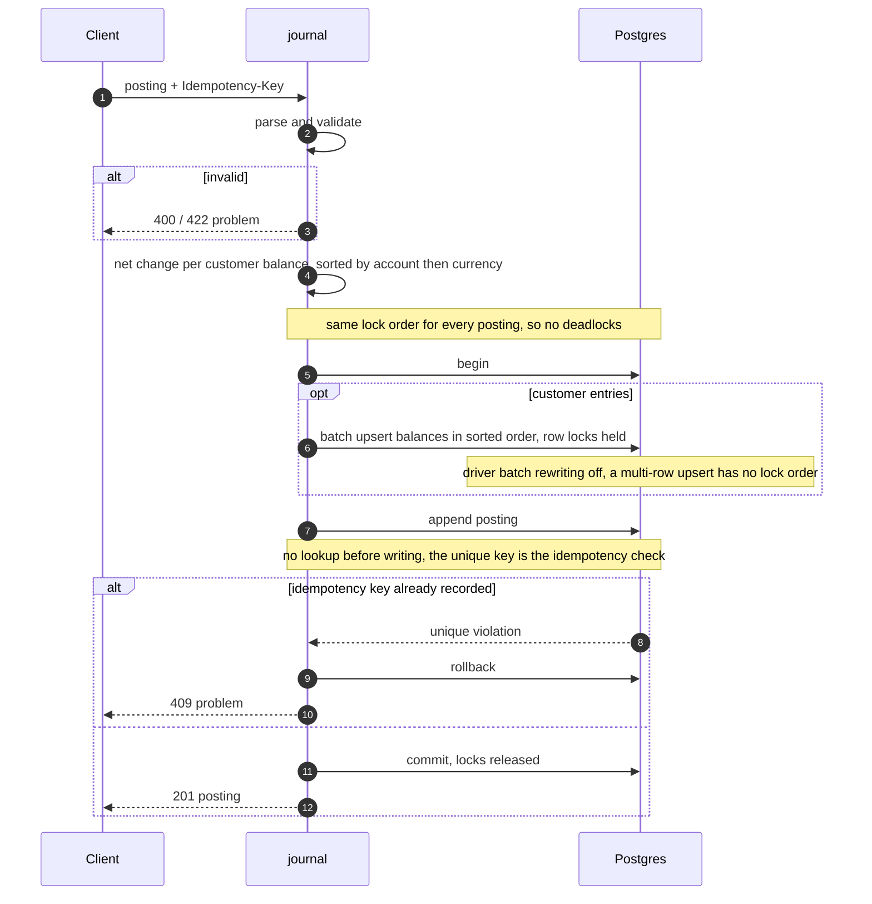

# Posting

Behaviour: [transaction-posting](../../../openspec/specs/journal/transaction-posting/spec.md). Contract: [OpenAPI](../journal-app/src/main/openapi/openapi.yaml). Tables: [data model](data-model.md).

