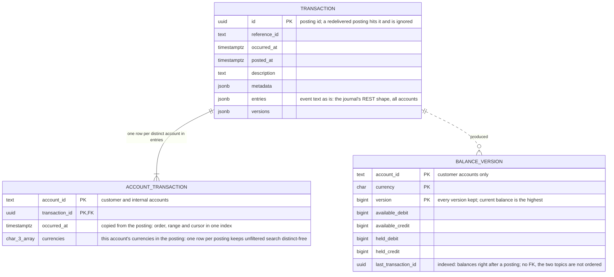

# Data model

Behaviour: [transaction-search](../../../openspec/specs/query/transaction-search/spec.md), [account-balances](../../../openspec/specs/query/account-balances/spec.md). Tables: [changelog](../query-app/src/main/resources/db/changelog/db.changelog-master.yaml). Source events: [Avro](../../journal/journal-events/src/main/avro/).

