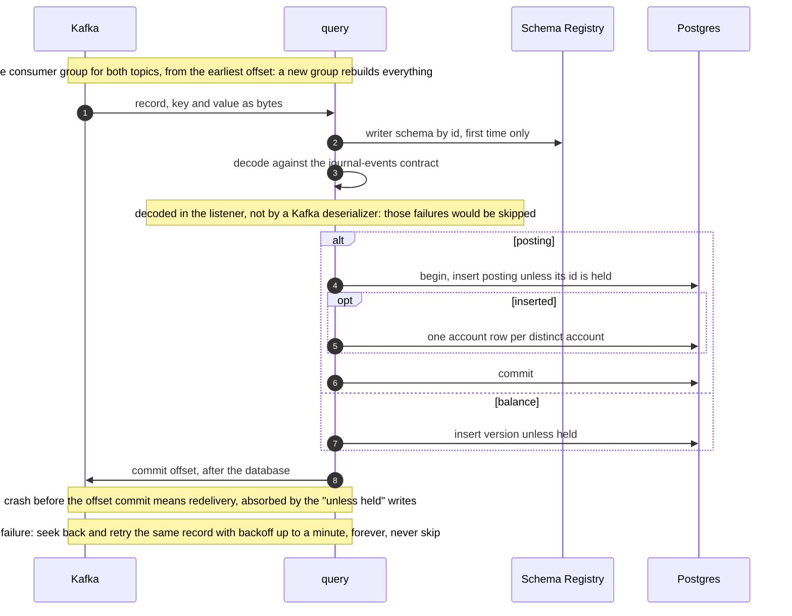

# Ingestion

Behaviour: [transaction-search](../../../openspec/specs/query/transaction-search/spec.md), [account-balances](../../../openspec/specs/query/account-balances/spec.md). Events: [change-events](../../../openspec/specs/journal/change-events/spec.md), [Avro](../../journal/journal-events/src/main/avro/). Settings: [application.yaml](../query-app/src/main/resources/application.yaml). Tables: [data model](data-model.md).

