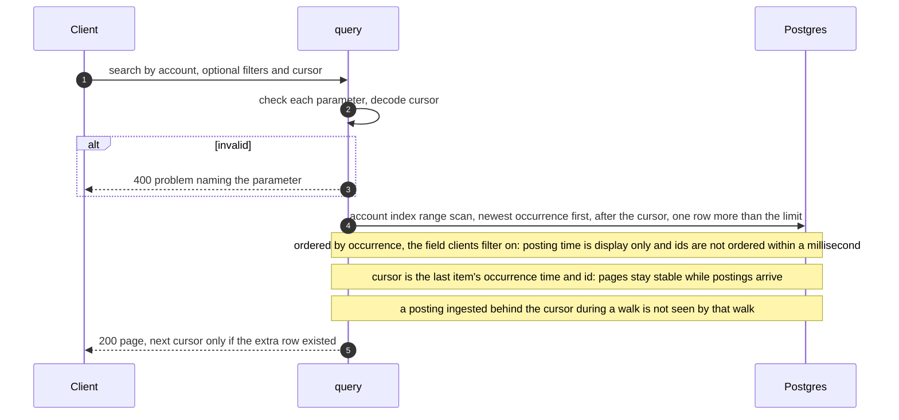

# Transaction search

Behaviour: [transaction-search](../../../openspec/specs/query/transaction-search/spec.md). Contract: [OpenAPI](../query-app/src/main/openapi/openapi.yaml). Tables: [data model](data-model.md).

